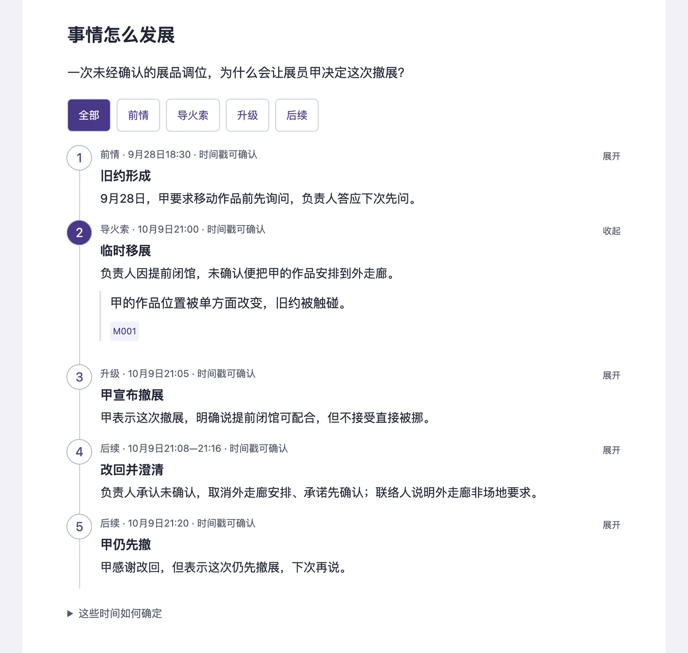

<h1 align="center">MellonEater · 知瓜</h1>

<p align="center">把聊天记录整理成一份讲清前因后果、点得回原文的报告。</p>

<p align="center">
  <a href="#快速开始">快速开始</a> ·
  <a href="#怎样导入微信记录">微信导入</a> ·
  <a href="docs/RESUMABLE_READING.md">工作流与用量</a>
</p>

<p align="center">
  
</p>

*网页版报告预览，使用仓库中的[虚构展览案例](data/samples/compact-prehistory.json)。*

## 知瓜能做什么

- **看懂经过** — 从聊天里提取前情、关键转折与现状，用互动时间线串起来。
- **回查原文** — 点引用编号查看消息和截图。把各方说法、行为判断和待确认的事项放在同一份报告里。
- **继续分析与导出** — 保存已完成步骤，按任务进度恢复。报告可导出为独立 HTML，也可在浏览器打印为 PDF。

## 快速开始

当前以 **macOS** 为主。下载仓库后双击 `start.command`，也可以在终端用下面的命令启动。

```sh
git clone https://github.com/lotus116/MellonEater.git
cd MellonEater
./start.command
```

1. 打开 [本地工作台](http://127.0.0.1:8765)。首次启动可以先选内置的合成案例，也可以导入 TXT、JSON、JSONL、截图或微信 ZIP。
2. 在「模型与接入设置」中选择已登录的 Codex，或填写 DeepSeek 的模型和密钥。也可以在本机使用 [`.env.example`](.env.example) 配置模型。
3. 核对材料后点击「生成分析报告」。在「网页版报告」里可展开时间线、跳转原文，也可打印或存为 PDF。

## 怎样导入微信记录

在 Mac 微信打开合并聊天记录，滚动加载需要的图片。通过「转发 → 其他应用」交给 [Dukou](https://github.com/qzz0518/Dukou) 暂存为 ZIP。回到知瓜，点击「导入微信 ZIP」，选择文件、填写群名和起止日期，再预览文字与图片的对应关系。[详细导入说明](docs/MAC_ACCESS.md)

> 案例、原图、运行记录与密钥保存在本机并由 Git 忽略。选择云端模型并启动分析时，用于本次分析的文字和图片会发送给相应的服务商。

## 项目文档

[生成、续跑与导出](docs/RESUMABLE_READING.md) · [分析规则与 Skill](skills/chigua-analysis/SKILL.md) · [验证记录](docs/VALIDATION.md) · [项目计划](docs/PLAN.md)
